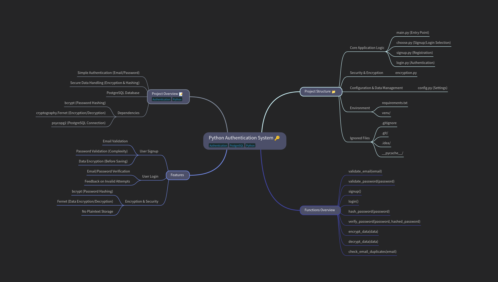

# Auth-System - Secure Python Authentication System

[](https://www.python.org/downloads/)
[](LICENSE)
[](https://cryptography.io/)

## 📌 Project Overview

A production-focused authentication system built with Python demonstrating industry-standard cryptographic practices, secure credential management, and PostgreSQL integration. This project showcases fundamental security principles including password hashing, data encryption, input validation, and database-backed user authentication.

----------

## Project Structure

📂 **auth-system/**  
│  
├── 📁 **Core Application Logic (Authentication & User Flow)**  
│ ├── 📄 `main.py` → Entry point of the application, directs user input.  
│ ├── 📄 `choose.py` → Guides user through signup or login selection.  
│ ├── 📄 `signup.py` → Handles user registration & email validation.  
│ ├── 📄 `login.py` → Manages user authentication.  
│  
├── 📁 **Security & Encryption**  
│ ├── 📄 `encryption.py` → Encrypts & decrypts user credentials, hashes passwords.  
│  
├── 📁 **Configuration & Data Management**  
│ ├── 📄 `config.py` → Contains file paths, database connection settings & cryptographic key management.  
│  
├── 📁 **Environment & Dependencies**  
│ ├── 📄 `requirements.txt` → Lists required dependencies.  
│ ├── 📁 `venv/` → Virtual environment folder.  
│  
├── 📁 **Ignored & Auto-Generated Files**  
│ ├── 📄 `.gitignore` → Specifies files ignored by Git.  
│ ├── 📁 `.git/` → Git repository metadata.  
│ ├── 📁 `.idea/` → IDE-specific settings (PyCharm).  
│ ├── 📁 `__pycache__/` → Stores compiled Python files.

## Structure's vizualization


----------
## 🎯 Key Features

### Security Implementation
- **Bcrypt Password Hashing**: Adaptive hashing with automatic salt generation
- **Fernet Encryption**: Symmetric encryption (AES-128 CBC + HMAC) for data protection
- **SQL Injection Prevention**: Parameterized queries throughout
- **Input Validation**: Email format and password strength verification
- **Duplicate Prevention**: Email uniqueness enforcement at database level

### Authentication Flow
- **User Registration**: Secure signup with validation
- **User Login**: Credential verification with encrypted comparison
- **Password Validation**: Minimum 8 characters, uppercase, special character requirements
- **Email Validation**: RFC-compliant email format checking

### Data Management
- **PostgreSQL Backend**: ACID-compliant relational database
- **UUID User IDs**: Secure, non-sequential user identification
- **Encrypted Storage**: Sensitive data encrypted at rest
- **Connection Pooling**: Efficient database resource utilization

---

## 🛠️ Technologies

- **Python 3.8+**
- **bcrypt** - Password hashing
- **cryptography (Fernet)** - Data encryption
- **psycopg2** - PostgreSQL database adapter
- **PostgreSQL 12+** - Database backend
- **uuid** - Unique identifier generation
- **re** - Regular expression validation

---

### Component Overview

**Core Application Logic:**
- `main.py` - Entry point directing user to signup/login
- `choose.py` - Menu system for authentication flow selection
- `signup.py` - Handles registration, validation, duplicate checking
- `login.py` - Manages authentication and session creation

**Security Layer:**
- `encryption.py` - Bcrypt hashing, Fernet encryption/decryption

**Configuration:**
- `config.py` - Database connection, file paths, crypto keys

---

## 🚀 Getting Started

### Prerequisites

1. **Python 3.8 or higher**
2. **PostgreSQL 12 or higher**
3. **pip** (Python package manager)

### Installation

1. **Clone the repository**
```bash
git clone https://github.com/JuliaGlocka/auth-system.git
cd auth-system
```

2. **Create virtual environment**
```bash
python -m venv venv

# Activate (Windows)
venv\Scripts\activate

# Activate (Linux/Mac)
source venv/bin/activate
```

3. **Install dependencies**
```bash
pip install -r requirements.txt
```

If `requirements.txt` doesn't exist, install manually:
```bash
pip install bcrypt cryptography psycopg2-binary
```

4. **Set up PostgreSQL Database**

Create database and users table:
```sql
-- Connect to PostgreSQL
psql -U postgres

-- Create database
CREATE DATABASE auth_system;

-- Connect to the database
\c auth_system

-- Create users table
CREATE TABLE users (
    id UUID PRIMARY KEY DEFAULT gen_random_uuid(),
    email VARCHAR(255) UNIQUE NOT NULL,
    password_hash TEXT NOT NULL,
    created_at TIMESTAMP DEFAULT CURRENT_TIMESTAMP,
    updated_at TIMESTAMP DEFAULT CURRENT_TIMESTAMP
);

-- Create index for faster email lookups
CREATE INDEX idx_users_email ON users(email);
```

5. **Configure Database Connection**

**Recommended: Use Environment Variables**

Create `.env` file in project root:
```bash
# Database Configuration
DB_NAME=auth_system
DB_USER=postgres
DB_PASSWORD=your_secure_password_here
DB_HOST=localhost
DB_PORT=5432

# Encryption Keys
FERNET_KEY=generate_this_key  # See below
SECRET_KEY=generate_this_key
```

Generate Fernet key:
```python
from cryptography.fernet import Fernet
print(Fernet.generate_key().decode())
```

**Alternative: Update config.py directly** (not recommended for production)
```python
# config.py
DB_CONFIG = {
    'dbname': 'auth_system',
    'user': 'postgres',
    'password': 'your_password',
    'host': 'localhost',
    'port': '5432'
}
```

### Running the Application

```bash
python main.py
```

---

## 📖 Usage Guide

### Starting the Application

```
Welcome to Auth System!
1. Sign Up
2. Log In
0. Exit

Choose an option: 
```

### Sign Up Flow

1. **Select Sign Up** (Option 1)
```
Enter your email: user@example.com
```

2. **Email Validation**
   - Must be valid email format (RFC-compliant)
   - Checks for existing account

3. **Enter Password**
```
Enter your password: 
```

4. **Password Requirements**
   - Minimum 8 characters
   - At least one uppercase letter
   - At least one special character (!@#$%^&*(),.?":{}|<>)

5. **Confirmation**
```
✓ Account created successfully!
```

### Login Flow

1. **Select Log In** (Option 2)
```
Enter your email: user@example.com
Enter your password: ********
```

2. **Authentication**
   - Verifies email exists
   - Compares hashed password
   - Decrypts user data if successful

3. **Success/Failure**
```
✓ Login successful! Welcome back.
✗ Invalid credentials. Please try again.
```

---

## 🔐 Security Architecture

### Password Security

**Bcrypt Hashing:**
```python
import bcrypt

# Hashing (during signup)
salt = bcrypt.gensalt()
hashed = bcrypt.hashpw(password.encode('utf-8'), salt)

# Verification (during login)
is_valid = bcrypt.checkpw(password.encode('utf-8'), stored_hash)
```

**Key Features:**
- Automatic salt generation (prevents rainbow table attacks)
- Configurable work factor (cost parameter)
- Adaptive hashing (increases security over time)

### Data Encryption

**Fernet Symmetric Encryption:**
```python
from cryptography.fernet import Fernet

# Encryption
cipher = Fernet(encryption_key)
encrypted_data = cipher.encrypt(data.encode())

# Decryption
decrypted_data = cipher.decrypt(encrypted_data).decode()
```

**Properties:**
- AES-128 in CBC mode
- HMAC for authentication
- Built-in timestamp verification
- Prevents tampering and replay attacks

### Validation Layer

**Email Validation:**
```python
import re

def validate_email(email: str) -> bool:
    pattern = r'^[a-zA-Z0-9._%+-]+@[a-zA-Z0-9.-]+\.[a-zA-Z]{2,}$'
    return re.match(pattern, email) is not None
```

**Password Validation:**
```python
def validate_password(password: str) -> bool:
    if len(password) < 8:
        return False
    if not any(c.isupper() for c in password):
        return False
    if not any(c in '!@#$%^&*(),.?":{}|<>' for c in password):
        return False
    return True
```

---

## 🧪 Testing

### Manual Test Cases

**Signup Tests:**
- [ ] Valid email and password → Success
- [ ] Invalid email format → Error
- [ ] Weak password (< 8 chars) → Error
- [ ] Password without uppercase → Error
- [ ] Password without special char → Error
- [ ] Duplicate email → Error
- [ ] Database connection failure → Error

**Login Tests:**
- [ ] Valid credentials → Success
- [ ] Invalid email → Error
- [ ] Invalid password → Error
- [ ] Non-existent account → Error
- [ ] Case sensitivity test
- [ ] Special characters in password

### Future: Automated Testing

```python
# tests/test_authentication.py
import unittest
from signup import validate_email, validate_password

class TestAuthentication(unittest.TestCase):
    def test_valid_email(self):
        self.assertTrue(validate_email("user@example.com"))
    
    def test_invalid_email(self):
        self.assertFalse(validate_email("invalid-email"))
    
    def test_password_too_short(self):
        self.assertFalse(validate_password("Short1!"))
    
    def test_password_no_uppercase(self):
        self.assertFalse(validate_password("longpassword1!"))
    
    def test_valid_password(self):
        self.assertTrue(validate_password("SecurePass123!"))
```

---

## 🔧 Configuration

### Database Schema

```sql
CREATE TABLE users (
    id UUID PRIMARY KEY DEFAULT gen_random_uuid(),
    email VARCHAR(255) UNIQUE NOT NULL,
    password_hash TEXT NOT NULL,
    encrypted_data TEXT,
    is_active BOOLEAN DEFAULT TRUE,
    failed_login_attempts INT DEFAULT 0,
    last_login TIMESTAMP,
    created_at TIMESTAMP DEFAULT CURRENT_TIMESTAMP,
    updated_at TIMESTAMP DEFAULT CURRENT_TIMESTAMP
);

-- Indexes for performance
CREATE INDEX idx_users_email ON users(email);
CREATE INDEX idx_users_active ON users(is_active);
```

### Environment Variables (Recommended)

```bash
# .env
DB_NAME=auth_system
DB_USER=postgres
DB_PASSWORD=your_secure_password
DB_HOST=localhost
DB_PORT=5432

# Fernet key (generate with: Fernet.generate_key())
FERNET_KEY=your_generated_fernet_key

# Application settings
MAX_LOGIN_ATTEMPTS=5
SESSION_TIMEOUT=3600  # seconds
PASSWORD_MIN_LENGTH=8
```

---

## 🚧 Known Limitations & Future Enhancements

### Current Limitations

| Issue | Impact | Priority |
|-------|--------|----------|
| Hardcoded credentials | Security risk | 🔴 CRITICAL |
| No rate limiting | Brute force vulnerability | 🔴 HIGH |
| No password reset | Poor UX | 🟡 MEDIUM |
| No email verification | Security gap | 🟡 MEDIUM |
| No session management | Stateless auth | 🟡 MEDIUM |
| CLI-only interface | Limited usability | 🟢 LOW |
| No audit logging | Compliance issue | 🟡 MEDIUM |

### Planned Enhancements

**Phase 1: Security Hardening**
- [ ] Move all secrets to `.env` file
- [ ] Implement rate limiting (max 5 attempts per 15 minutes)
- [ ] Add account lockout mechanism
- [ ] Implement session management with tokens
- [ ] Add comprehensive audit logging
- [ ] Increase password requirements (12+ chars, lowercase, number)

**Phase 2: Features**
- [ ] Password reset via email
- [ ] Email verification on signup
- [ ] Two-factor authentication (2FA/MFA)
- [ ] Remember me functionality
- [ ] Password change capability
- [ ] Account deletion

**Phase 3: Architecture**
- [ ] REST API with FastAPI/Flask
- [ ] JWT token-based authentication
- [ ] Repository pattern for data access
- [ ] Service layer for business logic
- [ ] Dependency injection
- [ ] Unit and integration tests

**Phase 4: DevOps**
- [ ] Docker containerization
- [ ] docker-compose for local development
- [ ] CI/CD pipeline (GitHub Actions)
- [ ] Automated security scanning
- [ ] Code coverage reporting
- [ ] Performance monitoring

---

## 📊 Performance Considerations

### Database Optimization
- Connection pooling for concurrent users
- Indexed email column for fast lookups
- Prepared statements for query optimization

### Caching Strategies (Future)
- Redis for session storage
- Cache frequently accessed user data
- Rate limit counters in Redis

### Scalability (Future)
- Horizontal scaling with load balancer
- Read replicas for database
- Microservices architecture

---

## 🤝 Contributing

Contributions are welcome! Please follow these guidelines:

1. Fork the repository
2. Create a feature branch (`git checkout -b feature/AmazingFeature`)
3. Follow PEP 8 style guide
4. Add tests for new functionality
5. Update documentation
6. Commit changes (`git commit -m 'Add AmazingFeature'`)
7. Push to branch (`git push origin feature/AmazingFeature`)
8. Open a Pull Request

### Code Style

- Follow PEP 8 conventions
- Use type hints for function signatures
- Add docstrings for all functions
- Keep functions small and focused
- Write descriptive commit messages

---

## 🔐 Security Considerations

**For Production Deployment:**

1. **Never commit secrets** - Use environment variables
2. **Use HTTPS** - Encrypt data in transit
3. **Implement rate limiting** - Prevent brute force
4. **Add logging** - Monitor authentication attempts
5. **Regular updates** - Keep dependencies current
6. **Penetration testing** - Regular security audits
7. **Compliance** - Follow GDPR/CCPA requirements
8. **Backup strategy** - Regular database backups

---

## 📄 License

This project is open source and available under the MIT License.

---

## 📞 Contact

**Julia Głocka**
- Email: glockajulia@gmail.com
- GitHub: [@JuliaGlocka](https://github.com/JuliaGlocka)
- LinkedIn: [Connect with me](https://linkedin.com/in/julia-glocka)

---

## 🙏 Acknowledgments

- [bcrypt](https://github.com/pyca/bcrypt) - Password hashing library
- [cryptography](https://cryptography.io/) - Fernet encryption implementation
- [psycopg2](https://www.psycopg.org/) - PostgreSQL adapter for Python
- [OWASP](https://owasp.org/) - Security best practices

---

## 📚 Additional Resources

- [OWASP Authentication Cheat Sheet](https://cheatsheetseries.owasp.org/cheatsheets/Authentication_Cheat_Sheet.html)
- [bcrypt Documentation](https://github.com/pyca/bcrypt/)
- [Fernet Specification](https://github.com/fernet/spec/)
- [PostgreSQL Security](https://www.postgresql.org/docs/current/security.html)
- [Python Password Hashing](https://docs.python.org/3/library/hashlib.html)
